# Diagrama de clases

Sacado del código de `main` al 17/11/2026 (PRs 1 a 6 integrados). Empieza por los paquetes, sigue con el detalle de cada paquete y termina con una vista por cada patrón GoF. Al final está todo junto, como referencia. GitHub dibuja los bloques `mermaid` directamente.

Se omiten los constructores públicos, los métodos privados auxiliares y las constantes de dibujo de la vista. `EstadoCaja` es una clase anidada de `Memento`.

# General

## Paquetes

Los 12 paquetes con sus clases. Las flechas punteadas son dependencias: un paquete importa clases del otro.

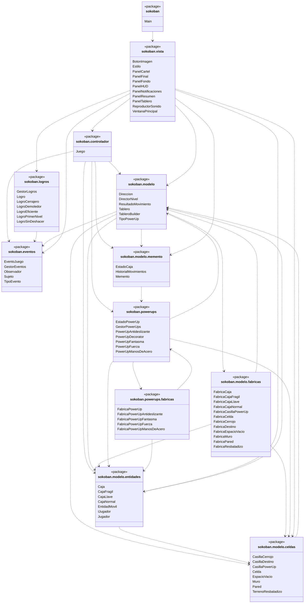

# Por paquete

## Controlador y eventos

Juego es el controlador y el punto de entrada al modelo. Main arranca la ventana. Los eventos viajan por GestorEventos. Las cajas vacías son clases de otros paquetes.

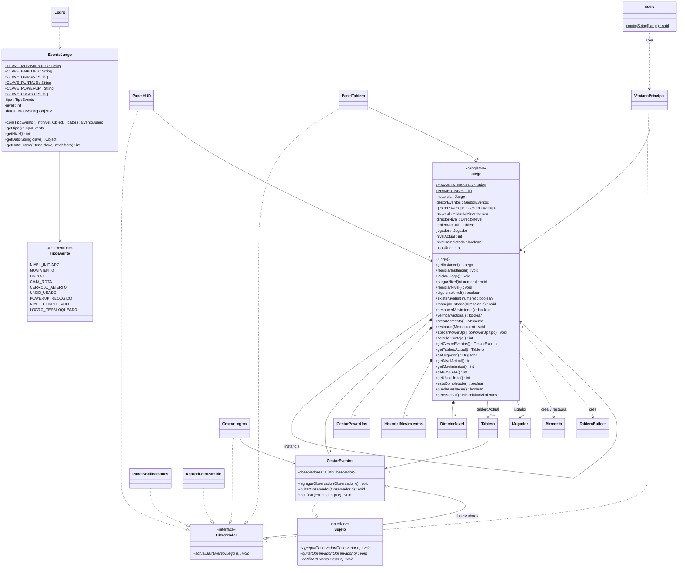

## Modelo: tablero y niveles

Tablero guarda el estado de un nivel y aplica las reglas de movimiento. DirectorNivel y TableroBuilder lo construyen desde el archivo del nivel. Las cajas vacías son clases de otros paquetes.

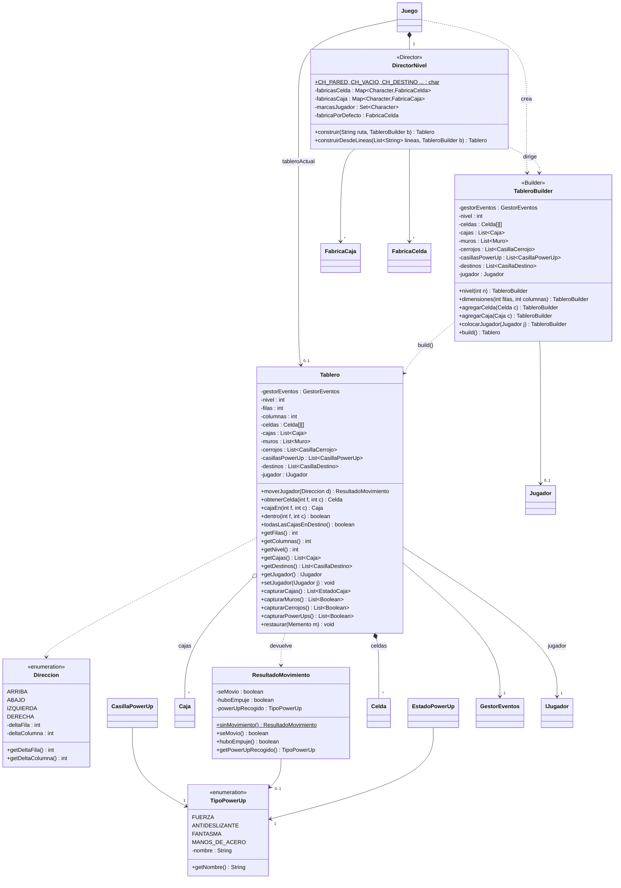

## Celdas

Cada tipo de casilla del tablero. Celda guarda la posición y cada subclase decide si se puede pisar. Las cajas vacías son clases de otros paquetes.

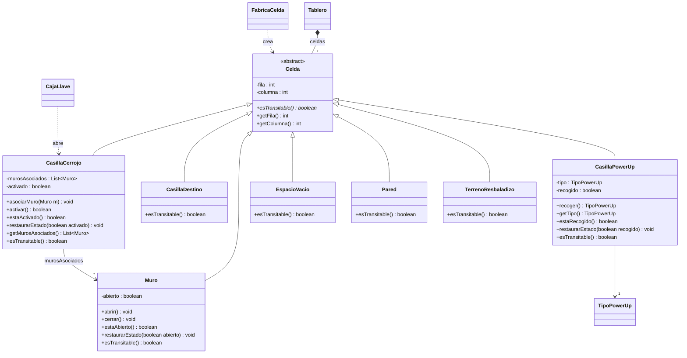

## Jugador y cajas

Jugador y cajas comparten posición y movimiento a través de EntidadMovil. IJugador es la interfaz que decoran los power-ups. Las cajas vacías son clases de otros paquetes.

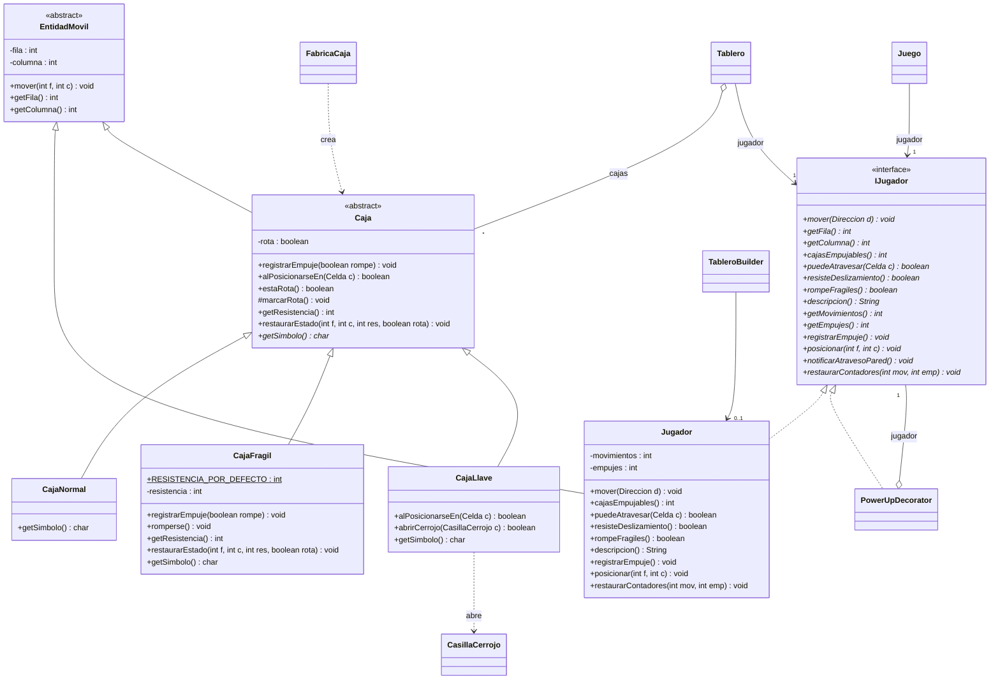

## Fábricas del modelo

Una fábrica por cada carácter del archivo de nivel: siete para celdas y tres para cajas. Las cajas vacías son clases de otros paquetes.

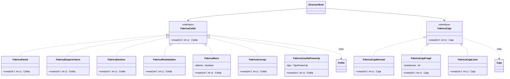

## Memento

La foto del estado que se guarda antes de cada movimiento para poder deshacer. Las cajas vacías son clases de otros paquetes.

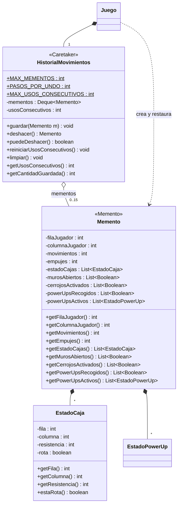

## Power-ups

Los cuatro decoradores, sus fábricas y GestorPowerUps, que arma y desarma la cadena. Las cajas vacías son clases de otros paquetes.

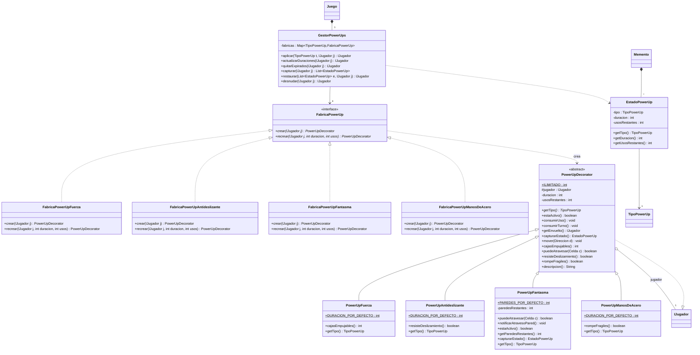

## Logros

Cada logro decide si se desbloquea mirando los eventos que le pasa GestorLogros. Las cajas vacías son clases de otros paquetes.

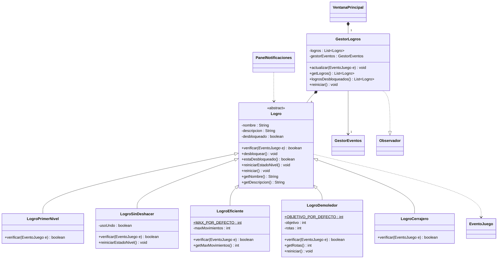

## Vista (Swing)

La interfaz en Swing. Los paneles se enteran de los cambios como observadores y la ventana arma todo. Las cajas vacías son clases de otros paquetes.

```mermaid
classDiagram
direction TB
class BotonImagen {
    -imagen : Image
    -etiqueta : String
    #paintComponent(Graphics g) void
}
class Estilo {
    <<utility>>
    ~TEXTO, ETIQUETA, SOMBRA, PANEL, BORDE : Color$
    ~fuente(float tam)$ Font
    ~texto(Graphics2D g, String s, int x, int y, float tam, int estilo, Color c)$ int
    ~textoCentrado(Graphics2D g, String s, int x, int ancho, int y, float tam, Color c)$ void
}
class JButton
class JFrame
class JPanel
class PanelCartel {
    <<abstract>>
    -cartel : BufferedImage
    -recorte : Rectangle
    -botones : Rectangle[]
    -hover : int
    #alPresionar(int boton)* void
    #dibujarContenido(Graphics2D g)* void
    #abrir() void
    #cerrar() void
    #atajo(int tecla, Runnable accion) void
    #paintComponent(Graphics g) void
}
class PanelFinal {
    -alVolverAIniciar : Runnable
    -alCerrar : Runnable
    +mostrar(Runnable volverAIniciar, Runnable cerrar) void
    #alPresionar(int boton) void
    #dibujarContenido(Graphics2D g) void
}
class PanelFondo {
    +ANCHO_REF : int$
    +ALTO_REF : int$
    -fondo : Image
    -componentes : List~Component~
    -zonas : List~Rectangle~
    +agregar(Component c, int x, int y, int ancho, int alto) void
    +agregarCentrado(Component c, int x, int y, int ancho, int alto) void
    +getPreferredSize() Dimension
    +doLayout() void
    #paintComponent(Graphics g) void
}
class PanelHUD {
    -juego : Juego
    -btnUndo : BotonImagen
    -btnReiniciar : BotonImagen
    -nivel : int
    -movimientos : int
    -empujes : int
    -estado : String
    +getBotonDeshacer() JButton
    +getBotonReiniciar() JButton
    +actualizar(EventoJuego e) void
    +refrescar() void
    #paintComponent(Graphics g) void
}
class PanelNotificaciones {
    -aviso : String
    -temporizador : Timer
    +actualizar(EventoJuego e) void
    +mostrarLogro(Logro l) void
    #paintComponent(Graphics g) void
}
class PanelResumen {
    -lineas : String[]
    -logros : int
    -totalLogros : int
    -alContinuar : Runnable
    -alReiniciar : Runnable
    +mostrar(int nivel, int mov, int emp, int undos, int puntaje, int logros, Runnable continuar, Runnable reiniciar) void
    #alPresionar(int boton) void
    #dibujarContenido(Graphics2D g) void
}
class PanelTablero {
    -lado : int
    -juego : Juego
    -imagenes : Map~String,Image~
    +actualizar(EventoJuego e) void
    +getPreferredSize() Dimension
    #paintComponent(Graphics g) void
}
class ReproductorSonido {
    -sonidos : Map~TipoEvento,Clip~
    +actualizar(EventoJuego e) void
    +reproducir(TipoEvento t) void
}
class VentanaPrincipal {
    -juego : Juego
    -gestorEventos : GestorEventos
    -gestorLogros : GestorLogros
    -panelTablero : PanelTablero
    -panelHUD : PanelHUD
    -panelNotificaciones : PanelNotificaciones
    -reproductorSonido : ReproductorSonido
    -panelResumen : PanelResumen
    -panelFinal : PanelFinal
    +actualizar(EventoJuego e) void
}
class GestorLogros
class Juego
class Logro
class Main
class Observador
VentanaPrincipal ..|> Observador
PanelTablero ..|> Observador
PanelHUD ..|> Observador
PanelNotificaciones ..|> Observador
ReproductorSonido ..|> Observador
JFrame <|-- VentanaPrincipal
JPanel <|-- PanelTablero
JPanel <|-- PanelHUD
JPanel <|-- PanelNotificaciones
JPanel <|-- PanelCartel
JPanel <|-- PanelFondo
PanelCartel <|-- PanelResumen
PanelCartel <|-- PanelFinal
JButton <|-- BotonImagen
VentanaPrincipal --> "1" Juego
VentanaPrincipal *-- "1" GestorLogros
VentanaPrincipal *-- "1" PanelTablero
VentanaPrincipal *-- "1" PanelHUD
VentanaPrincipal *-- "1" PanelNotificaciones
VentanaPrincipal *-- "1" ReproductorSonido
VentanaPrincipal *-- "1" PanelResumen
VentanaPrincipal *-- "1" PanelFinal
PanelTablero --> "1" Juego
PanelHUD --> "1" Juego
PanelHUD *-- "2" BotonImagen
Main ..> VentanaPrincipal : crea
PanelNotificaciones ..> Logro
VentanaPrincipal ..> PanelFondo : crea
PanelCartel ..> Estilo
classDef externa fill:#f1f4f7,stroke:#9aa7b4,stroke-dasharray:4 3,color:#5b6876
cssClass "GestorLogros,Juego,Logro,Main,Observador" externa
```

# Patrones

## Observer

GestorEventos es el sujeto: Juego y Tablero publican eventos, y la vista, los logros y el sonido los reciben sin que el modelo los conozca.

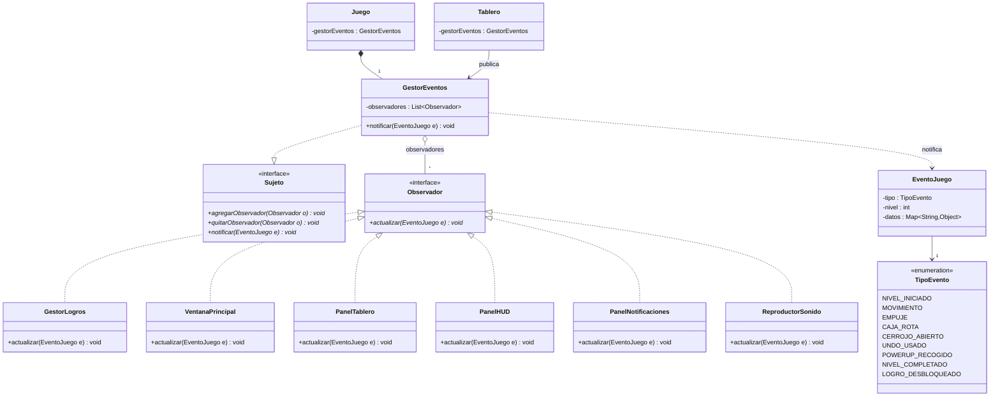

## Memento

Juego es el originador y HistorialMovimientos el cuidador: guarda las últimas 15 fotos, cada deshacer retrocede 5 movimientos y se puede usar 3 veces seguidas.

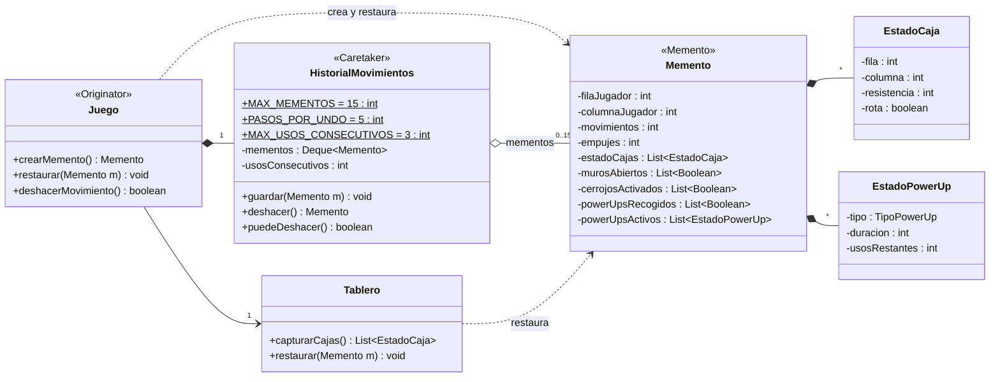

## Decorator

Cada power-up envuelve al jugador y cambia una sola capacidad. Se pueden apilar, y GestorPowerUps arma y desarma la cadena cuando vencen.

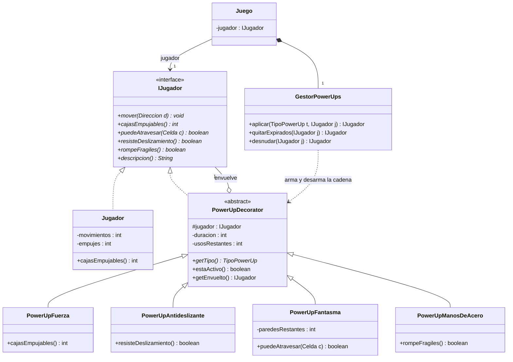

## Singleton

Una única instancia de Juego, que la vista obtiene con getInstance(). reiniciarInstancia() existe para que las pruebas arranquen limpias.

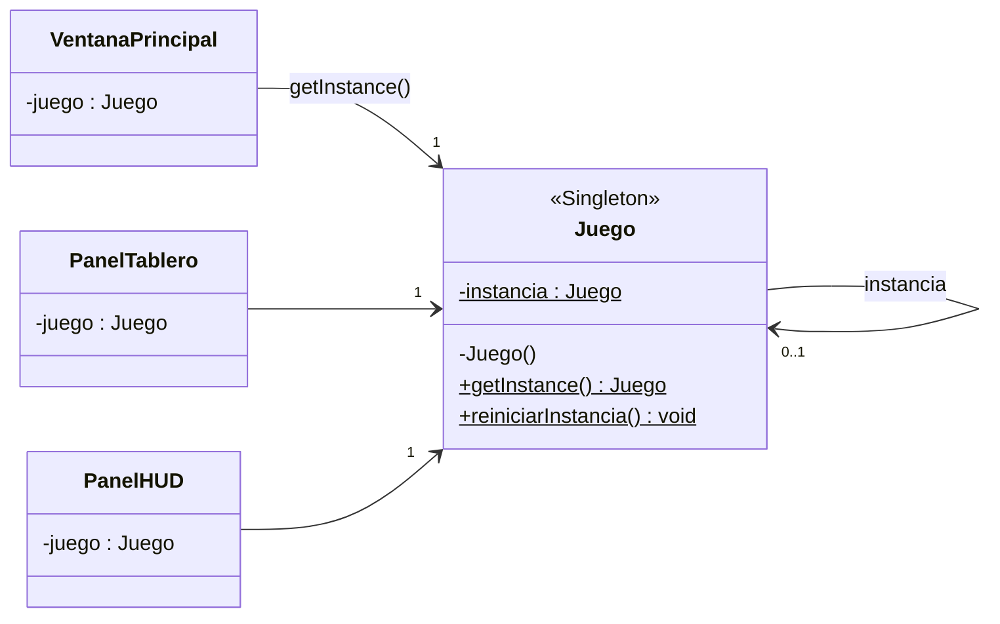

## Factory Method

Tres familias de fábricas: celdas y cajas para leer los niveles, y power-ups para armar los decoradores.

```mermaid
classDiagram
direction TB
class FabricaCelda {
  <<interface>>
  +crear(int f, int c)* Celda
}
class FabricaCaja {
  <<interface>>
  +crear(int f, int c)* Caja
}
class FabricaPowerUp {
  <<interface>>
  +crear(IJugador j)* PowerUpDecorator
  +recrear(IJugador j, int duracion, int usos)* PowerUpDecorator
}
class FabricaPared
class FabricaEspacioVacio
class FabricaDestino
class FabricaResbaladizo
class FabricaMuro {
  -abierto : boolean
}
class FabricaCerrojo
class FabricaCasillaPowerUp {
  -tipo : TipoPowerUp
}
class FabricaCajaNormal
class FabricaCajaFragil {
  -resistencia : int
}
class FabricaCajaLlave
class FabricaPowerUpFuerza
class FabricaPowerUpAntideslizante
class FabricaPowerUpFantasma
class FabricaPowerUpManosDeAcero
class DirectorNivel {
  -fabricasCelda : Map~Character,FabricaCelda~
  -fabricasCaja : Map~Character,FabricaCaja~
}
class GestorPowerUps {
  -fabricas : Map~TipoPowerUp,FabricaPowerUp~
}
class Celda {
  <<abstract>>
}
class Caja {
  <<abstract>>
}
class PowerUpDecorator {
  <<abstract>>
}
FabricaCelda <|.. FabricaPared
FabricaCelda <|.. FabricaEspacioVacio
FabricaCelda <|.. FabricaDestino
FabricaCelda <|.. FabricaResbaladizo
FabricaCelda <|.. FabricaMuro
FabricaCelda <|.. FabricaCerrojo
FabricaCelda <|.. FabricaCasillaPowerUp
FabricaCaja <|.. FabricaCajaNormal
FabricaCaja <|.. FabricaCajaFragil
FabricaCaja <|.. FabricaCajaLlave
FabricaPowerUp <|.. FabricaPowerUpFuerza
FabricaPowerUp <|.. FabricaPowerUpAntideslizante
FabricaPowerUp <|.. FabricaPowerUpFantasma
FabricaPowerUp <|.. FabricaPowerUpManosDeAcero
DirectorNivel --> "*" FabricaCelda
DirectorNivel --> "*" FabricaCaja
GestorPowerUps --> "4" FabricaPowerUp
FabricaCelda ..> Celda : crea
FabricaCaja ..> Caja : crea
FabricaPowerUp ..> PowerUpDecorator : crea
```

## Builder

DirectorNivel lee el archivo del nivel y le va pasando las piezas a TableroBuilder, que entrega el Tablero armado.

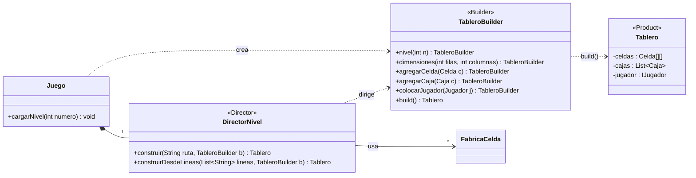

# Referencia

## Todo junto

Las 72 clases en un solo diagrama, con todos sus miembros y relaciones. Es muy grande: conviene usar las vistas de arriba y dejar esta para buscar algo puntual.

```mermaid
classDiagram
direction TB

namespace sokoban {
  class Main {
    +main(String[] args)$ void
  }
}

namespace controlador {
  class Juego {
    <<Singleton>>
    +CARPETA_NIVELES : String$
    +PRIMER_NIVEL : int$
    -instancia : Juego$
    -gestorEventos : GestorEventos
    -gestorPowerUps : GestorPowerUps
    -historial : HistorialMovimientos
    -directorNivel : DirectorNivel
    -tableroActual : Tablero
    -jugador : IJugador
    -nivelActual : int
    -nivelCompletado : boolean
    -usosUndo : int
    -Juego()
    +getInstance()$ Juego
    +reiniciarInstancia()$ void
    +iniciarJuego() void
    +cargarNivel(int numero) void
    +reiniciarNivel() void
    +siguienteNivel() boolean
    +existeNivel(int numero) boolean
    +manejarEntrada(Direccion d) void
    +deshacerMovimiento() boolean
    +verificarVictoria() boolean
    +crearMemento() Memento
    +restaurar(Memento m) void
    +aplicarPowerUp(TipoPowerUp tipo) void
    +calcularPuntaje() int
    +getGestorEventos() GestorEventos
    +getTableroActual() Tablero
    +getJugador() IJugador
    +getNivelActual() int
    +getMovimientos() int
    +getEmpujes() int
    +getUsosUndo() int
    +estaCompletado() boolean
    +puedeDeshacer() boolean
    +getHistorial() HistorialMovimientos
  }
}

namespace eventos {
  class Sujeto {
    <<interface>>
    +agregarObservador(Observador o)* void
    +quitarObservador(Observador o)* void
    +notificar(EventoJuego e)* void
  }
  class Observador {
    <<interface>>
    +actualizar(EventoJuego e)* void
  }
  class GestorEventos {
    -observadores : List~Observador~
    +agregarObservador(Observador o) void
    +quitarObservador(Observador o) void
    +notificar(EventoJuego e) void
  }
  class EventoJuego {
    +CLAVE_MOVIMIENTOS : String$
    +CLAVE_EMPUJES : String$
    +CLAVE_UNDOS : String$
    +CLAVE_PUNTAJE : String$
    +CLAVE_POWERUP : String$
    +CLAVE_LOGRO : String$
    -tipo : TipoEvento
    -nivel : int
    -datos : Map~String,Object~
    +con(TipoEvento t, int nivel, Object... datos)$ EventoJuego
    +getTipo() TipoEvento
    +getNivel() int
    +getDato(String clave) Object
    +getDatoEntero(String clave, int defecto) int
  }
  class TipoEvento {
    <<enumeration>>
    NIVEL_INICIADO
    MOVIMIENTO
    EMPUJE
    CAJA_ROTA
    CERROJO_ABIERTO
    UNDO_USADO
    POWERUP_RECOGIDO
    NIVEL_COMPLETADO
    LOGRO_DESBLOQUEADO
  }
}

namespace logros {
  class GestorLogros {
    -logros : List~Logro~
    -gestorEventos : GestorEventos
    +actualizar(EventoJuego e) void
    +getLogros() List~Logro~
    +logrosDesbloqueados() List~Logro~
    +reiniciar() void
  }
  class Logro {
    <<abstract>>
    -nombre : String
    -descripcion : String
    -desbloqueado : boolean
    +verificar(EventoJuego e)* boolean
    +desbloquear() void
    +estaDesbloqueado() boolean
    +reiniciarEstadoNivel() void
    +reiniciar() void
    +getNombre() String
    +getDescripcion() String
  }
  class LogroPrimerNivel {
    +verificar(EventoJuego e) boolean
  }
  class LogroSinDeshacer {
    -usoUndo : boolean
    +verificar(EventoJuego e) boolean
    +reiniciarEstadoNivel() void
  }
  class LogroEficiente {
    +MAX_POR_DEFECTO : int$
    -maxMovimientos : int
    +verificar(EventoJuego e) boolean
    +getMaxMovimientos() int
  }
  class LogroDemoledor {
    +OBJETIVO_POR_DEFECTO : int$
    -objetivo : int
    -rotas : int
    +verificar(EventoJuego e) boolean
    +getRotas() int
    +reiniciar() void
  }
  class LogroCerrajero {
    +verificar(EventoJuego e) boolean
  }
}

namespace modelo {
  class Tablero {
    -gestorEventos : GestorEventos
    -nivel : int
    -filas : int
    -columnas : int
    -celdas : Celda[][]
    -cajas : List~Caja~
    -muros : List~Muro~
    -cerrojos : List~CasillaCerrojo~
    -casillasPowerUp : List~CasillaPowerUp~
    -destinos : List~CasillaDestino~
    -jugador : IJugador
    +moverJugador(Direccion d) ResultadoMovimiento
    +obtenerCelda(int f, int c) Celda
    +cajaEn(int f, int c) Caja
    +dentro(int f, int c) boolean
    +todasLasCajasEnDestino() boolean
    +getFilas() int
    +getColumnas() int
    +getNivel() int
    +getCajas() List~Caja~
    +getDestinos() List~CasillaDestino~
    +getJugador() IJugador
    +setJugador(IJugador j) void
    +capturarCajas() List~EstadoCaja~
    +capturarMuros() List~Boolean~
    +capturarCerrojos() List~Boolean~
    +capturarPowerUps() List~Boolean~
    +restaurar(Memento m) void
  }
  class TableroBuilder {
    <<Builder>>
    -gestorEventos : GestorEventos
    -nivel : int
    -celdas : Celda[][]
    -cajas : List~Caja~
    -muros : List~Muro~
    -cerrojos : List~CasillaCerrojo~
    -casillasPowerUp : List~CasillaPowerUp~
    -destinos : List~CasillaDestino~
    -jugador : Jugador
    +nivel(int n) TableroBuilder
    +dimensiones(int filas, int columnas) TableroBuilder
    +agregarCelda(Celda c) TableroBuilder
    +agregarCaja(Caja c) TableroBuilder
    +colocarJugador(Jugador j) TableroBuilder
    +build() Tablero
  }
  class DirectorNivel {
    <<Director>>
    +CH_PARED, CH_VACIO, CH_DESTINO ... : char$
    -fabricasCelda : Map~Character,FabricaCelda~
    -fabricasCaja : Map~Character,FabricaCaja~
    -marcasJugador : Set~Character~
    -fabricaPorDefecto : FabricaCelda
    +construir(String ruta, TableroBuilder b) Tablero
    +construirDesdeLineas(List~String~ lineas, TableroBuilder b) Tablero
  }
  class ResultadoMovimiento {
    -seMovio : boolean
    -huboEmpuje : boolean
    -powerUpRecogido : TipoPowerUp
    +sinMovimiento()$ ResultadoMovimiento
    +seMovio() boolean
    +huboEmpuje() boolean
    +getPowerUpRecogido() TipoPowerUp
  }
  class Direccion {
    <<enumeration>>
    ARRIBA
    ABAJO
    IZQUIERDA
    DERECHA
    -deltaFila : int
    -deltaColumna : int
    +getDeltaFila() int
    +getDeltaColumna() int
  }
  class TipoPowerUp {
    <<enumeration>>
    FUERZA
    ANTIDESLIZANTE
    FANTASMA
    MANOS_DE_ACERO
    -nombre : String
    +getNombre() String
  }
}

namespace celdas {
  class Celda {
    <<abstract>>
    -fila : int
    -columna : int
    +esTransitable()* boolean
    +getFila() int
    +getColumna() int
  }
  class Pared {
    +esTransitable() boolean
  }
  class EspacioVacio {
    +esTransitable() boolean
  }
  class CasillaDestino {
    +esTransitable() boolean
  }
  class TerrenoResbaladizo {
    +esTransitable() boolean
  }
  class Muro {
    -abierto : boolean
    +abrir() void
    +cerrar() void
    +estaAbierto() boolean
    +restaurarEstado(boolean abierto) void
    +esTransitable() boolean
  }
  class CasillaCerrojo {
    -murosAsociados : List~Muro~
    -activado : boolean
    +asociarMuro(Muro m) void
    +activar() boolean
    +estaActivado() boolean
    +restaurarEstado(boolean activado) void
    +getMurosAsociados() List~Muro~
    +esTransitable() boolean
  }
  class CasillaPowerUp {
    -tipo : TipoPowerUp
    -recogido : boolean
    +recoger() TipoPowerUp
    +getTipo() TipoPowerUp
    +estaRecogido() boolean
    +restaurarEstado(boolean recogido) void
    +esTransitable() boolean
  }
}

namespace entidades {
  class EntidadMovil {
    <<abstract>>
    -fila : int
    -columna : int
    +mover(int f, int c) void
    +getFila() int
    +getColumna() int
  }
  class IJugador {
    <<interface>>
    +mover(Direccion d)* void
    +getFila()* int
    +getColumna()* int
    +cajasEmpujables()* int
    +puedeAtravesar(Celda c)* boolean
    +resisteDeslizamiento()* boolean
    +rompeFragiles()* boolean
    +descripcion()* String
    +getMovimientos()* int
    +getEmpujes()* int
    +registrarEmpuje()* void
    +posicionar(int f, int c)* void
    +notificarAtravesoPared()* void
    +restaurarContadores(int mov, int emp)* void
  }
  class Jugador {
    -movimientos : int
    -empujes : int
    +mover(Direccion d) void
    +cajasEmpujables() int
    +puedeAtravesar(Celda c) boolean
    +resisteDeslizamiento() boolean
    +rompeFragiles() boolean
    +descripcion() String
    +registrarEmpuje() void
    +posicionar(int f, int c) void
    +restaurarContadores(int mov, int emp) void
  }
  class Caja {
    <<abstract>>
    -rota : boolean
    +registrarEmpuje(boolean rompe) void
    +alPosicionarseEn(Celda c) boolean
    +estaRota() boolean
    #marcarRota() void
    +getResistencia() int
    +restaurarEstado(int f, int c, int res, boolean rota) void
    +getSimbolo()* char
  }
  class CajaNormal {
    +getSimbolo() char
  }
  class CajaFragil {
    +RESISTENCIA_POR_DEFECTO : int$
    -resistencia : int
    +registrarEmpuje(boolean rompe) void
    +romperse() void
    +getResistencia() int
    +restaurarEstado(int f, int c, int res, boolean rota) void
    +getSimbolo() char
  }
  class CajaLlave {
    +alPosicionarseEn(Celda c) boolean
    +abrirCerrojo(CasillaCerrojo c) boolean
    +getSimbolo() char
  }
}

namespace fabricas {
  class FabricaCelda {
    <<interface>>
    +crear(int f, int c)* Celda
  }
  class FabricaPared {
    +crear(int f, int c) Celda
  }
  class FabricaEspacioVacio {
    +crear(int f, int c) Celda
  }
  class FabricaDestino {
    +crear(int f, int c) Celda
  }
  class FabricaResbaladizo {
    +crear(int f, int c) Celda
  }
  class FabricaMuro {
    -abierto : boolean
    +crear(int f, int c) Celda
  }
  class FabricaCerrojo {
    +crear(int f, int c) Celda
  }
  class FabricaCasillaPowerUp {
    -tipo : TipoPowerUp
    +crear(int f, int c) Celda
  }
  class FabricaCaja {
    <<interface>>
    +crear(int f, int c)* Caja
  }
  class FabricaCajaNormal {
    +crear(int f, int c) Caja
  }
  class FabricaCajaFragil {
    -resistencia : int
    +crear(int f, int c) Caja
  }
  class FabricaCajaLlave {
    +crear(int f, int c) Caja
  }
}

namespace memento {
  class Memento {
    <<Memento>>
    -filaJugador : int
    -columnaJugador : int
    -movimientos : int
    -empujes : int
    -estadoCajas : List~EstadoCaja~
    -murosAbiertos : List~Boolean~
    -cerrojosActivados : List~Boolean~
    -powerUpsRecogidos : List~Boolean~
    -powerUpsActivos : List~EstadoPowerUp~
    +getFilaJugador() int
    +getColumnaJugador() int
    +getMovimientos() int
    +getEmpujes() int
    +getEstadoCajas() List~EstadoCaja~
    +getMurosAbiertos() List~Boolean~
    +getCerrojosActivados() List~Boolean~
    +getPowerUpsRecogidos() List~Boolean~
    +getPowerUpsActivos() List~EstadoPowerUp~
  }
  class EstadoCaja {
    -fila : int
    -columna : int
    -resistencia : int
    -rota : boolean
    +getFila() int
    +getColumna() int
    +getResistencia() int
    +estaRota() boolean
  }
  class HistorialMovimientos {
    <<Caretaker>>
    +MAX_MEMENTOS : int$
    +PASOS_POR_UNDO : int$
    +MAX_USOS_CONSECUTIVOS : int$
    -mementos : Deque~Memento~
    -usosConsecutivos : int
    +guardar(Memento m) void
    +deshacer() Memento
    +puedeDeshacer() boolean
    +reiniciarUsosConsecutivos() void
    +limpiar() void
    +getUsosConsecutivos() int
    +getCantidadGuardada() int
  }
}

namespace powerups {
  class GestorPowerUps {
    -fabricas : Map~TipoPowerUp,FabricaPowerUp~
    +aplicar(TipoPowerUp t, IJugador j) IJugador
    +actualizarDuraciones(IJugador j) IJugador
    +quitarExpirados(IJugador j) IJugador
    +capturar(IJugador j) List~EstadoPowerUp~
    +restaurar(List~EstadoPowerUp~ e, IJugador j) IJugador
    +desnudar(IJugador j) IJugador
  }
  class EstadoPowerUp {
    -tipo : TipoPowerUp
    -duracion : int
    -usosRestantes : int
    +getTipo() TipoPowerUp
    +getDuracion() int
    +getUsosRestantes() int
  }
  class PowerUpDecorator {
    <<abstract>>
    +ILIMITADO : int$
    #jugador : IJugador
    -duracion : int
    -usosRestantes : int
    +getTipo()* TipoPowerUp
    +estaActivo() boolean
    +consumirUso() void
    +consumirTurno() void
    +getEnvuelto() IJugador
    +capturarEstado() EstadoPowerUp
    +mover(Direccion d) void
    +cajasEmpujables() int
    +puedeAtravesar(Celda c) boolean
    +resisteDeslizamiento() boolean
    +rompeFragiles() boolean
    +descripcion() String
  }
  class PowerUpFuerza {
    +DURACION_POR_DEFECTO : int$
    +cajasEmpujables() int
    +getTipo() TipoPowerUp
  }
  class PowerUpAntideslizante {
    +DURACION_POR_DEFECTO : int$
    +resisteDeslizamiento() boolean
    +getTipo() TipoPowerUp
  }
  class PowerUpFantasma {
    +PAREDES_POR_DEFECTO : int$
    -paredesRestantes : int
    +puedeAtravesar(Celda c) boolean
    +notificarAtravesoPared() void
    +estaActivo() boolean
    +getParedesRestantes() int
    +capturarEstado() EstadoPowerUp
    +getTipo() TipoPowerUp
  }
  class PowerUpManosDeAcero {
    +DURACION_POR_DEFECTO : int$
    +rompeFragiles() boolean
    +getTipo() TipoPowerUp
  }
  class FabricaPowerUp {
    <<interface>>
    +crear(IJugador j)* PowerUpDecorator
    +recrear(IJugador j, int duracion, int usos)* PowerUpDecorator
  }
  class FabricaPowerUpFuerza {
    +crear(IJugador j) PowerUpDecorator
    +recrear(IJugador j, int duracion, int usos) PowerUpDecorator
  }
  class FabricaPowerUpAntideslizante {
    +crear(IJugador j) PowerUpDecorator
    +recrear(IJugador j, int duracion, int usos) PowerUpDecorator
  }
  class FabricaPowerUpFantasma {
    +crear(IJugador j) PowerUpDecorator
    +recrear(IJugador j, int duracion, int usos) PowerUpDecorator
  }
  class FabricaPowerUpManosDeAcero {
    +crear(IJugador j) PowerUpDecorator
    +recrear(IJugador j, int duracion, int usos) PowerUpDecorator
  }
}

namespace vista {
  class VentanaPrincipal {
    -juego : Juego
    -gestorEventos : GestorEventos
    -gestorLogros : GestorLogros
    -panelTablero : PanelTablero
    -panelHUD : PanelHUD
    -panelNotificaciones : PanelNotificaciones
    -reproductorSonido : ReproductorSonido
    -panelResumen : PanelResumen
    -panelFinal : PanelFinal
    +actualizar(EventoJuego e) void
  }
  class PanelTablero {
    -lado : int
    -juego : Juego
    -imagenes : Map~String,Image~
    +actualizar(EventoJuego e) void
    +getPreferredSize() Dimension
    #paintComponent(Graphics g) void
  }
  class PanelHUD {
    -juego : Juego
    -btnUndo : BotonImagen
    -btnReiniciar : BotonImagen
    -nivel : int
    -movimientos : int
    -empujes : int
    -estado : String
    +getBotonDeshacer() JButton
    +getBotonReiniciar() JButton
    +actualizar(EventoJuego e) void
    +refrescar() void
    #paintComponent(Graphics g) void
  }
  class PanelNotificaciones {
    -aviso : String
    -temporizador : Timer
    +actualizar(EventoJuego e) void
    +mostrarLogro(Logro l) void
    #paintComponent(Graphics g) void
  }
  class ReproductorSonido {
    -sonidos : Map~TipoEvento,Clip~
    +actualizar(EventoJuego e) void
    +reproducir(TipoEvento t) void
  }
  class PanelCartel {
    <<abstract>>
    -cartel : BufferedImage
    -recorte : Rectangle
    -botones : Rectangle[]
    -hover : int
    #alPresionar(int boton)* void
    #dibujarContenido(Graphics2D g)* void
    #abrir() void
    #cerrar() void
    #atajo(int tecla, Runnable accion) void
    #paintComponent(Graphics g) void
  }
  class PanelResumen {
    -lineas : String[]
    -logros : int
    -totalLogros : int
    -alContinuar : Runnable
    -alReiniciar : Runnable
    +mostrar(int nivel, int mov, int emp, int undos, int puntaje, int logros, Runnable continuar, Runnable reiniciar) void
    #alPresionar(int boton) void
    #dibujarContenido(Graphics2D g) void
  }
  class PanelFinal {
    -alVolverAIniciar : Runnable
    -alCerrar : Runnable
    +mostrar(Runnable volverAIniciar, Runnable cerrar) void
    #alPresionar(int boton) void
    #dibujarContenido(Graphics2D g) void
  }
  class PanelFondo {
    +ANCHO_REF : int$
    +ALTO_REF : int$
    -fondo : Image
    -componentes : List~Component~
    -zonas : List~Rectangle~
    +agregar(Component c, int x, int y, int ancho, int alto) void
    +agregarCentrado(Component c, int x, int y, int ancho, int alto) void
    +getPreferredSize() Dimension
    +doLayout() void
    #paintComponent(Graphics g) void
  }
  class BotonImagen {
    -imagen : Image
    -etiqueta : String
    #paintComponent(Graphics g) void
  }
  class Estilo {
    <<utility>>
    ~TEXTO, ETIQUETA, SOMBRA, PANEL, BORDE : Color$
    ~fuente(float tam)$ Font
    ~texto(Graphics2D g, String s, int x, int y, float tam, int estilo, Color c)$ int
    ~textoCentrado(Graphics2D g, String s, int x, int ancho, int y, float tam, Color c)$ void
  }
}

namespace swing {
  class JFrame
  class JPanel
  class JButton
}

%% ---------- Herencia y realizacion ----------
GestorEventos ..|> Sujeto
GestorLogros ..|> Observador
VentanaPrincipal ..|> Observador
PanelTablero ..|> Observador
PanelHUD ..|> Observador
PanelNotificaciones ..|> Observador
ReproductorSonido ..|> Observador

Logro <|-- LogroPrimerNivel
Logro <|-- LogroSinDeshacer
Logro <|-- LogroEficiente
Logro <|-- LogroDemoledor
Logro <|-- LogroCerrajero

Celda <|-- Pared
Celda <|-- EspacioVacio
Celda <|-- CasillaDestino
Celda <|-- TerrenoResbaladizo
Celda <|-- Muro
Celda <|-- CasillaCerrojo
Celda <|-- CasillaPowerUp

EntidadMovil <|-- Jugador
EntidadMovil <|-- Caja
Caja <|-- CajaNormal
Caja <|-- CajaFragil
Caja <|-- CajaLlave

IJugador <|.. Jugador
IJugador <|.. PowerUpDecorator
PowerUpDecorator <|-- PowerUpFuerza
PowerUpDecorator <|-- PowerUpAntideslizante
PowerUpDecorator <|-- PowerUpFantasma
PowerUpDecorator <|-- PowerUpManosDeAcero

FabricaCelda <|.. FabricaPared
FabricaCelda <|.. FabricaEspacioVacio
FabricaCelda <|.. FabricaDestino
FabricaCelda <|.. FabricaResbaladizo
FabricaCelda <|.. FabricaMuro
FabricaCelda <|.. FabricaCerrojo
FabricaCelda <|.. FabricaCasillaPowerUp
FabricaCaja <|.. FabricaCajaNormal
FabricaCaja <|.. FabricaCajaFragil
FabricaCaja <|.. FabricaCajaLlave
FabricaPowerUp <|.. FabricaPowerUpFuerza
FabricaPowerUp <|.. FabricaPowerUpAntideslizante
FabricaPowerUp <|.. FabricaPowerUpFantasma
FabricaPowerUp <|.. FabricaPowerUpManosDeAcero

JFrame <|-- VentanaPrincipal
JPanel <|-- PanelTablero
JPanel <|-- PanelHUD
JPanel <|-- PanelNotificaciones
JPanel <|-- PanelCartel
JPanel <|-- PanelFondo
PanelCartel <|-- PanelResumen
PanelCartel <|-- PanelFinal
JButton <|-- BotonImagen

%% ---------- Asociaciones ----------
Juego --> "0..1" Juego : instancia
Juego *-- "1" GestorEventos
Juego *-- "1" GestorPowerUps
Juego *-- "1" HistorialMovimientos
Juego *-- "1" DirectorNivel
Juego --> "0..1" Tablero : tableroActual
Juego --> "1" IJugador : jugador

GestorEventos o-- "*" Observador : observadores
EventoJuego --> "1" TipoEvento
GestorLogros *-- "5" Logro
GestorLogros --> "1" GestorEventos

DirectorNivel --> "*" FabricaCelda
DirectorNivel --> "*" FabricaCaja
TableroBuilder --> "0..1" Jugador
Tablero *-- "*" Celda : celdas
Tablero o-- "*" Caja : cajas
Tablero --> "1" IJugador : jugador
Tablero --> "1" GestorEventos
CasillaCerrojo --> "*" Muro : murosAsociados
CasillaPowerUp --> "1" TipoPowerUp
ResultadoMovimiento --> "0..1" TipoPowerUp

HistorialMovimientos o-- "0..15" Memento : mementos
Memento *-- "*" EstadoCaja
Memento *-- "*" EstadoPowerUp
EstadoPowerUp --> "1" TipoPowerUp

PowerUpDecorator o-- "1" IJugador : jugador
GestorPowerUps --> "4" FabricaPowerUp

VentanaPrincipal --> "1" Juego
VentanaPrincipal *-- "1" GestorLogros
VentanaPrincipal *-- "1" PanelTablero
VentanaPrincipal *-- "1" PanelHUD
VentanaPrincipal *-- "1" PanelNotificaciones
VentanaPrincipal *-- "1" ReproductorSonido
VentanaPrincipal *-- "1" PanelResumen
VentanaPrincipal *-- "1" PanelFinal
PanelTablero --> "1" Juego
PanelHUD --> "1" Juego
PanelHUD *-- "2" BotonImagen

%% ---------- Dependencias ----------
Main ..> VentanaPrincipal : crea
Juego ..> Memento : crea y restaura
Juego ..> TableroBuilder : crea
DirectorNivel ..> TableroBuilder : dirige
TableroBuilder ..> Tablero : build()
Tablero ..> ResultadoMovimiento : devuelve
Tablero ..> Direccion
CajaLlave ..> CasillaCerrojo : abre
FabricaCelda ..> Celda : crea
FabricaCaja ..> Caja : crea
FabricaPowerUp ..> PowerUpDecorator : crea
GestorPowerUps ..> EstadoPowerUp
Logro ..> EventoJuego
PanelNotificaciones ..> Logro
VentanaPrincipal ..> PanelFondo : crea
PanelCartel ..> Estilo
```
